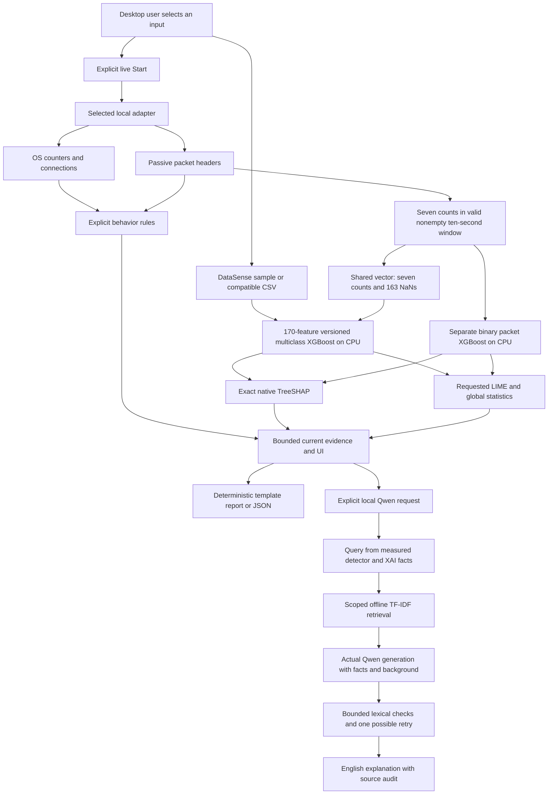

# Architecture

The framework separates observation, detection, explainability and language generation. The current desktop is a local research tool, with distinct real-data and synthetic paths. Read the historical research direction in [PROJECT_CONTEXT.md](PROJECT_CONTEXT.md); the boundaries below describe current source.

## Desktop runtime

```text
run_desktop.py
→ Electron window
→ owned Python desktop_backend service
→ authenticated HTTP on random 127.0.0.1 port
→ local UI / bounded analysis APIs
```

`framework/app/desktop/main.cjs` launches the project interpreter in development or the native frozen backend in a package. A fresh 64-character session token guards every desktop API/static request. The renderer has Node integration disabled, context isolation and sandboxing enabled, and remote requests blocked. Only the official Npcap help URLs are allowed to open externally.

`framework/app/desktop_backend.py` binds an ephemeral loopback port, reports readiness, serves requests and stops the monitor/server on shutdown or parent-input EOF. Electron sends shutdown on exit and terminates a child that exceeds its timeout. A second instance focuses the existing window. No observation, retraining or language generation starts automatically.

`framework/app/server.py` bounds requests to 10 MB, validates local host/origin, uses no debug mode and keeps uploads in memory. `run_app.py` is the optional developer/browser launcher using the same app on a chosen fixed port, without the desktop session token.

The NetSec UI serves Home (`/`), Live screening (`/live`), CSV analysis (`/csv`)
and Samples (`/samples`) as separate pages. Each analysis page retains the
XAI and explicitly requested local LLM panels. Shared local loading, error and
exit surfaces cover initialization, missing pages and session closure. API errors
remain JSON; recoverable input errors remain in the workspace. Exit cancellation
preserves current evidence; confirmed desktop exit stops the owned service.

The frameless Electron window uses themed draggable chrome and fixed
minimize/maximize/close controls. Its sandboxed preload exposes only named
window actions and state notifications, with sender/main-frame validation;
it does not expose arbitrary IPC or Node access. A separate local-file shell can
display startup/runtime failures while the HTTP service is unavailable. Browser
mode uses the same app surfaces within the tab and retains browser-owned chrome.

The package configuration stages CPU runtime resources, versioned models and Qwen separately from retained research originals. Windows NSIS releases have their own build/runtime verification records. Linux packaging requires its own verified native backend and is not runtime-tested in this Windows session. See [APP.md](APP.md).

## Real-data observation and model flow



The detector produces a prediction; XAI explains it; local retrieval supplies background; the optional language model rewrites evidence facts with that background. The language model does not detect traffic, identify new attacks, discover absent measurements or apply mitigation.

### CSV path

`framework/detection/trained_xgboost.py` verifies a frozen bundle/checkpoint hash, restores its schema and runs the actual saved 84-class classifier on CPU. Schema 2 accepts full or partial DataSense columns and preserves unavailable numeric and protocol inputs as NaN. `framework/data/feature_schema.py` aligns columns and supplies the common packet vector and CSV serialization. Schema 1 retains the original full-input contract. Validation labels/identifiers remain source metadata, not detector inputs.

The preserved original bundle points to `xgboost_joint_1_s42_20260929T182104981183Z`, with 80.0533% within-capture full-input validation accuracy, 480,405 training rows and 30,000 validation rows. `default_bundle()` selects an explicitly promoted `xgboost_partial` upgrade, or its separately validated `xgboost_partial_enhanced` successor, when available. Promotion compares the same seven-count validation profile; full-input scores and regressions remain separate. A corrupt selected bundle/checkpoint fails clearly. Held-out test scoring remains locked. Arbitrary PC packets still do not supply the full schema; missing-input retraining changes how the classifier handles that absence, not what the adapter measures. See [PARTIAL_TRAINING.md](PARTIAL_TRAINING.md).

### Live paths

`framework/data/live_monitor.py` owns adapter discovery, explicit Start/Stop, one worker, header/count collection, freshness and bounded history. Connections mode reads psutil OS counters/states about every two seconds. It executes transparent rules, not an ML model. Packet mode uses passive nonpromiscuous Scapy capture, filtered by callbacks to traffic involving the adapter's own IP/MAC. Windows needs separately installed Npcap.

`framework/detection/live_rules.py` checks observable thresholds, such as pending-connection bursts, SYN-only bursts and port sweeps. Benign-looking means no selected rule fired; suspicious means rule evidence needs review. Neither is a confirmed incident or measured classifier accuracy.

`framework/detection/packet_xgboost.py` loads the independent binary checkpoint and seven total-packet/TCP-flag counts. It checks its hash, validates count constraints and runs CPU prediction plus exact TreeSHAP. SYN+ACK contributes to both SYN and ACK. Empty windows have no model prediction; duration outside the ten-second tolerance skips the model.

When a schema-2 checkpoint is active, the same completed window also enters the
84-class classifier. Its report includes top-three tentative categories, model
version, observation ID, all 170 values and measured/missing coverage. The
binary result remains a labelled comparison; it never substitutes for multiclass
inference. CSV export requires the current observation ID and serializes this
identical vector. Application protocols and sensor logs remain missing. A
feature compatibility table identifies the exact mapping and the validation
scope. Arbitrary partial combinations are marked unvalidated.

The packet study achieved 95.4169% validation accuracy on 1,571 DataSense windows, using 20,966 training windows. Its seven-feature projection repeats 764 validation vectors present in training, and the publisher's exact extractor was unavailable. This different binary target does not measure live-PC accuracy or establish generalization. The actual recorded 640-packet Windows capture has benign-looking rules and a suspicious model result; the older benign-source PCAP replay also exposed a suspicious prediction. Preserve these observations.

Stopped, failed, expired or stale sessions clear old verdicts. Start/Stop is serialized separately from snapshot locks. Sessions last at most one hour, with bounded history, headers, connections and port-tracking sets. No payload/PCAP is saved, evidence is sent externally or mitigation applied. Additional packet-XAI/assistant requests bind to observation identity and reject a changed window rather than silently explaining a new sample.

The worker rotates count windows before process enumeration or model inference,
and runs both classifiers outside the capture lock. Deadlines are measured from
the previous boundary, so inference time does not deliberately extend each next
window. Delayed windows still fail the duration guard. Stop is checked again
before publishing a computed result.

## Explanation and language boundaries

`framework/xai/tree_shap.py` requests exact native XGBoost contributions and checks **bias + sum(all contributions) = raw class margin** for every class. Charts show signed predicted-class contributions; exports include all values and reconstruction error. Tree-cover/path-dependent reference statistics are not observed counterfactual traffic. Contributions are not probability percentage points or causal effects.

`framework/xai/model_evidence.py` uses actual LIME with a checksum-verified training-only 512-row reference, 2,048 perturbations and seed 42. The local surrogate explains a selected class score approximately. Its fidelity R² and surrogate prediction are shown; correlations may break and agreement can be poor. Unavailable numeric and categorical columns are excluded from surrogate distances and restored to NaN in every model call. Valid seven-count profiles use rounded, constrained count perturbations by canonical feature names; other profiles explicitly report unconstrained perturbations. Native split/gain/cover statistics and parameters describe the whole saved model, separately from local explanations. Missing SHAP contributions are retained for additivity but labelled default routing, not measured traffic.

`framework/llm/local_model.py` uses actual Qwen2.5-0.5B-Instruct Q4_K_M through llama.cpp. It verifies the pinned GGUF hash, runs on CPU with two threads / 2,048 context tokens / at most 200 output tokens, and closes the model after each requested generation. It rewrites compact source facts, top-three category hypotheses, feature coverage, profile limitations and two SHAP directions. For partial input, these include a measured contribution and missing-routing contribution when both exist. Rule/model disagreement remains explicit. Numerical SHAP/LIME evidence stays available separately for audit; the small model does not interpret raw mixed attribution units.

`framework/rag/retrieval.py` searches twelve checked project-curated passages
using standard-library TF-IDF cosine similarity on CPU. Packet/CSV scopes stay
separate. Two passages of at most 300 bytes each fit a 700-byte background
context. Weak supported queries receive at most one deterministic topic
expansion; unrelated literal queries abstain. Source and content hashes identify
the actual frozen knowledge used. This is local RAG, not web research or an
additional embedding/language model.

The actual Qwen prompt contains derived facts and that retrieved background.
`framework/rag/grounding.py` checks label, retained feature names, explicit
directions, uncertainty, percentages, source identifiers and truncation. A failed
first response may trigger one corrective generation; two failures return an
error without a template substitute. These lexical heuristics are not a learned
critic or proof of factual/citation correctness. The UI exposes passages and
attempts separately from measured traffic evidence. See [RAG.md](RAG.md).

Actual pre-RAG generation and resource observations are recorded in
`artifacts/desktop/verification/local_llm.json`; actual retrieval-conditioned
generation for two validation samples is recorded in `rag-generation.json` in
the same directory. These execution checks are not LLM quality benchmarks.
Generated wording still needs verification.

`research_template.py` and `live_template.py` are deterministic evidence formatters. The original `provider.py` / `TemplateProvider` belongs to the separate synthetic pipeline and remains credential-free. Templates are never labelled actual LLM inference.

## Original offline synthetic pipeline

```text
dataset/demo/sample_traffic.csv
→ DemoDetector: seeded Random Forest
→ standardized nearest-neighbor novelty gate
→ simplified feature or distance rankings
→ structured context
→ TemplateProvider
→ CLI report
```

`run_demo.py` composes `framework/data/loader.py`, `detection/demo_detector.py`, `xai/explainer.py`, `llm/provider.py` and `pipeline/security_pipeline.py`. The six invented features are packet rate, byte rate, SYN ratio, connection rate, unique destinations and average packet size. Only explicit training rows enter fitting; four demonstration rows remain separate.

Known-class confidence is an uncalibrated Random Forest score. The novelty threshold is 1.5 times the training-only 95th percentile of leave-one-out standardized nearest-neighbor distances, with a 0.25 minimum. A larger distance yields UNKNOWN even if the classifier selects a familiar class. UNKNOWN has no calibrated class probability and does not establish a new attack family.

Known/benign rankings multiply global forest importance by absolute standardized deviation from the benign centroid, then normalize. Unknown rankings normalize squared residuals to the nearest known row. These are simplified evidence, not SHAP, LIME or causal attribution. The deterministic report and future-provider prompt serialize actual supplied evidence without network access.

This CLI path stays offline, CPU-only and credential-free after dependency installation. It does not use the desktop's real models or local Qwen.

## HEM and research scope

`framework/detection/hem_adapter.py` retains an explicitly unavailable original-HEM bridge; it fails clearly instead of substituting DemoDetector. `experiment.hem_features` separately runs unchanged upstream HEM/Kitsune extraction on real offline PCAPs, producing 100 features per packet, not trained intrusion classification.

The separate DataSense CUDA study uses a closed-set HEM adaptation on another representation, alongside forest, XGBoost, KAN, CatBoost and LightGBM. That adaptation, original HEM feature extraction and original trained HEM unknown-attack inference are not interchangeable. The desktop executes neither original trained HEM nor that adaptation. Upstream HEM, IoT-Agent and efficient-kan remain isolated under `external/`.

DataSense provenance is not independently verified CIC-IIoT2025. Research validation, software checks and labelled live/unknown/held-out experiments are separate. Original HEM reproduction, unknown-attack evaluation, held-out test scoring, retrieval/explanation/LLM quality studies and a governed response layer remain future work. See [HEM_INTEGRATION.md](HEM_INTEGRATION.md), [FULL_DATA_TRAINING.md](FULL_DATA_TRAINING.md) and [PROJECT_STRUCTURE.md](PROJECT_STRUCTURE.md).

After changes, run the default `run_demo.py`, all four sample options and `python -m pytest evaluation -v`. Test success establishes software behavior; it is not a detection-accuracy or reasoning-quality claim.
