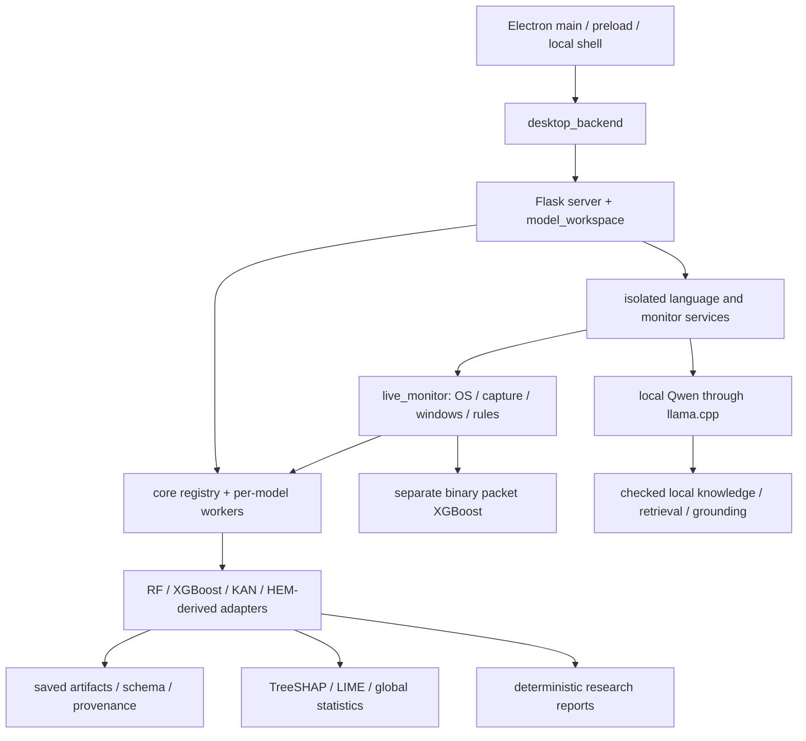

# NetSec runtime migration: Phase 0

Status: 12 October 2026. This is a source baseline and migration design, not an
implemented Rust backend. The owner explicitly allowed this preparatory work
while the independent ML studies continue. Stop at the Phase 0 gate; later phases
require approval. Training, experiments, model promotion and installed releases
are outside this phase.

## Evidence and scope

The current source was checked after reading `AGENTS.md`, all of
`PROJECT_CONTEXT.md`, `ARCHITECTURE.md`, `APP.md`, `DESKTOP.md`,
`LIVE_MONITORING.md`, `RAG.md` and `PARTIAL_INPUTS.md`. Those documents contain
historical snapshots; the differences below come from the current source.
This workspace has no `.git` directory, so no Git revision, clean-tree claim or
reviewable commits can be supplied. Use the Phase 0 source hashes and before-copy
under `artifacts/rust_migration/phase0/` as the local baseline. The original
`PROJECT_STRUCTURE.md` SHA256 is
`be1a4feb83001dcbb54e677a4d173291dc1543fda61efd1515d1d1acc6f72ee0`.

The migration covers the local runtime, HTTP adapter, Electron shell, frontend
modules and packaging. Python training/research tools, the original unavailable
HEM adapter, DemoDetector and the synthetic CLI remain Python. No accuracy,
unknown-attack performance or real-artifact parity follows from software tests.
Missing dependencies remain explicit unavailable states; a demo prediction or
template must never impersonate a failed research model or LLM.

## Verified current dependencies



| Source boundary | Verified responsibility and coupling |
| --- | --- |
| `app/desktop_backend.py`, `app/server.py` | Ephemeral authenticated loopback service; lazy composition; request policy; pages; legacy sample/CSV/live/XAI/assistant routes; resource shutdown. `create_app` also accepts a registry and language-service injection. |
| `app/model_workspace.py`, `core/{config,contracts,registry,worker}.py` | Four explicit model families, metadata and comparison, prepared CSV/row validation, per-family spawned workers, bounded waits, scoped errors and retry-driven worker reload. |
| `core/capabilities.py`, `detection/lazy_xgboost.py` | Separate optional language and capture processes; the legacy workspace uses an XGBoost facade. Polling an unused monitor does not start capture. Monitor workers can own model workers. |
| `detection/trained_xgboost.py`, `detection/adapters/xgboost.py` | Bundle and checkpoint verification, prediction, schema compatibility and legacy output. Both also compose XAI and deterministic reports. |
| `data/feature_schema.py`, `detection/packet_xgboost.py` | Shared CSV/missing-value mapping imports count names and validation from the packet detector. Packet detector loads a separate seven-count model and imports TreeSHAP. |
| `data/live_monitor.py`, `detection/live_rules.py` | OS interfaces/counters/connections, passive headers, ownership filtering, window rotation, threaded lifecycle, bounded state, rules and two model paths. |
| `xai/tree_shap.py`, `xai/model_evidence.py` | Native contributions with all-class margin reconstruction; package LIME and global statistics. LIME imports canonical packet names from detection. |
| `llm/local_model.py`, `rag/` | Actual requested local inference; checked TF-IDF retrieval and bounded lexical grounding/retry. Deterministic report providers remain distinct. |
| `data/research_data.py` | Imports `training.tracking.write_json`. This is a research utility dependency to keep out of the future runtime closure, not grounds to rewrite active training. |
| `pipeline/security_pipeline.py` | Separate demo composition through `BaseDetector`, simplified explainer and `LLMProvider`; out of migration scope. |

Paths in this table are relative to `framework/`. Static inspection confirmed
duplicated `file_sha256` in both XGBoost detector modules, with additional digest
logic in LLM/reference/build paths. A future pure digest helper must preserve
each caller's validation and error behavior.

The largest visible coupling points are `app.js` (1,068 physical lines),
`server.py` (419), `live_monitor.py` (369), and `main.cjs` (181). The newly present
Python `core/` alone has 485 lines, with additional family adapters. The brief's
approximately 2.7k-line description is an older estimate, not a verified current
runtime size. File length alone is not the modularity acceptance criterion.

### Drift that changes the migration contract

- The app already has a `/models` page, six model-workspace route patterns and
  four-family process isolation. Preserve these interfaces and their failures.
  Do not regress to eager model imports while introducing the Rust supervisor.
- The service also accepts `--model-config`. The lifecycle `return` allowlist
  includes `/models`. Both are absent from the migration brief's route list.
- `default_bundle()` selects explicitly promoted enhanced partial, then partial,
  then original XGBoost bundles. A malformed selected manifest/checkpoint is not
  a reason to silently choose another detector.
- Original HEM reproduction remains separate, but the current model workspace
  includes a HEM-derived adapter plus RF and KAN. The brief does not specify Rust
  equivalents for these formats. Preserve their current Python workers behind
  an explicit temporary model adapter during the XGBoost port; determine their
  longer-term runtime disposition at the Phase 1 gate. Do not claim an entirely
  Rust runtime while any such workers remain.
- `LIVE_MONITORING.md` includes older CSV-only/binary-only descriptions; current
  schema-2 code also provides a seven-count/163-missing multiclass path. New
  training context describes later forward/reversed studies; historical
  held-out-lock statements are not a current study-status report.
- `imdai-analysis.json` is a 116,946-byte saved validation-analysis export with
  prediction, model, explanation, reasoning, source and selected explanations.
  It lacks newer top-level `features` and `feature_coverage` fields. Preserve it
  as a historical response fixture with provenance, not the complete current
  response schema or a newly executed prediction. It has been relocated byte for
  byte to `evaluation/fixtures/rust_migration/legacy/imdai-analysis.json`; its
  SHA256 is `414996f909355c4a6030271d449239fb953f3228e6d9be78eaa84df5aa15b50a`.
- `.gitignore` ignores model formats globally and selected artifact directories,
  not every `artifacts/` path. Any retained tiny migration `.ubj`, `.npz` or PCAP
  fixture uses narrow exceptions in `.gitignore`; production artifacts remain
  excluded. Local migration logs, archives and duplicate regeneration outputs
  are also ignored. No Git repository was initialized.
- `core/config.py` currently accepts some undeclared keys and defaults a missing
  file. The requested strict Rust configuration is a deliberate compatibility
  change for bad configuration, to document/test before Phase 2.
- Invalid UTF-8 CSV currently raises `UnboundLocalError`: decoding runs before
  the function's local `import csv`, but its exception tuple references
  `csv.Error`. The observed upload response is the generic JSON 500. This is
  frozen as a baseline defect, not silently fixed during migration preparation.
- Flask/Werkzeug currently rejects `Host: [::1]` with JSON 400 despite that
  string appearing in `TRUSTED_HOSTS`. The fixture retains the observed response;
  any later correction needs an explicit compatibility decision.

## HTTP and process contract to freeze

The source contract is the complete Flask route table, including the registered
blueprint and automatic static route. Preserve field names, null/missing handling,
status codes, content types, attachment names and exact error strings. Framework
HEAD/OPTIONS behavior must also be captured rather than guessed.

| Method | Route(s) | Current contract to preserve |
| --- | --- | --- |
| GET | `/`, `/live`, `/csv`, `/samples`, `/models` | Home and unchanged workspace templates. |
| GET | `/loading`, `/error`, `/exit` | Lifecycle HTML; return only to `/`, `/live`, `/csv`, `/samples`, `/models`. |
| GET | `/static/<path>` | Local resources; missing resource is JSON 404. |
| GET | `/api/status`, `/api/samples`, `/api/example.csv` | Legacy XGBoost status, readable sample metadata and deterministic validation-example CSV. |
| POST | `/api/analyze`, `/api/upload`, `/api/explain` | Sample ID; multipart CSV; ordered feature list and CSV row index. Upload returns row predictions/features; analysis returns evidence/report. |
| GET | `/api/live/capabilities`, `/api/live/status`, `/api/live/report`, `/api/live/features.csv` | Capability/snapshot/export responses; feature export requires the current observation ID. |
| POST | `/api/live/start`, `/api/live/stop` | Explicit interface/mode start; JSON-object stop; never start observation implicitly. |
| POST | `/api/xai` | `kind` is sample, features or live; live evidence is bound to its observation ID. |
| GET / POST | `/api/assistant/status` / `/api/assistant/explain` | Status does not generate; explanation validates evidence, optionally obtains LIME, then actually generates. LIME failure alone does not prevent generation from valid SHAP. |
| GET | `/api/models`, `/api/models/comparison`, `/api/models/<model_id>/status` | Four-family catalog, protocol-aware comparison and selected-family metadata. |
| POST | `/api/models/<model_id>/predict`, `/api/models/<model_id>/upload` | Shared validation sample or ordered rows; separately validated prepared CSV; 1–500 rows. |
| POST | `/api/models/<model_id>/explain` | Exactly one selected row, explicit method (default `native`), scoped capability result. |

`desktop_backend` reads and removes the required 64-character lowercase-hex
`IMDAI_SESSION_TOKEN`, accepts `--bundle` and `--model-config`, binds
`127.0.0.1:0`, prints one readiness object with `type` and `port`, and cleans up
on stdin `shutdown` or EOF. Preserve `IMDAI_LLM_DIR`, all existing `IMDAI_*` names
and `X-IMDAI-Session`. Diagnostics belong on stderr without tokens/evidence.
The final executable name remains `imdai-backend[.exe]`.

When a session token is configured, every request requires a constant-time header
comparison. POST Origin checks compare `urlsplit(origin).netloc` with the request
Host; preserve this observed behavior in parity fixtures. Trusted hosts are
`localhost`, `127.0.0.1`, `[::1]`; upload/body limits are 500 rows and 10 MiB.
Every response receives `nosniff`, `no-store`, and:

```text
default-src 'self'; script-src 'self'; style-src 'self' 'unsafe-inline'; img-src 'self' data:; connect-src 'self'; frame-ancestors 'none'; form-action 'self'
```

Generic API failures return `{"error": ...}`. Model capability failures also
carry `model_id`, `capability`, `status`; incompatible errors are 400 and other
scoped failures 503. Non-API/non-static failing GETs use lifecycle HTML, preserving
404. Validation handlers and upload-limit failures retain their own JSON behavior.
The future panic boundary must choose the existing route's error shape, not
replace all responses with a new generic envelope.

Templates currently use includes, conditionals, `default`, inline conditionals
and `request.path`. Supply that context explicitly to minijinja and verify
undefined/default and HTML-escaping behavior. Preserve the Models template and
its separate static assets as well as the main workspace.

## Proposed module boundaries (not implemented)

The sanctioned future top-level workspace is `rust/`, with `app/` as the only
composition root naming concrete feature crates. `crates/core-api` holds DTOs,
ports and lifecycle contracts; `core` manages registration/supervision;
`shared` holds pure schema, labels, XGBoost/TreeSHAP, LIME, retrieval, grounding
and deterministic report logic. Native/file/HTTP implementations live under
`adapters/{bundle-fs,capture,llm,http}`. No Rust directory is created in Phase 0.

| Feature crate under `rust/crates/features/` | Responsibility and interface ownership |
| --- | --- |
| `sample-analysis` | Sample list and example CSV; sample selection/analysis; sample evidence resolved through the model port, including shared research samples. |
| `csv-analysis` | Raw/prepared CSV and ordered rows, coverage, predictions and analysis composition; model catalog/comparison/status and model upload/predict operations. |
| `xai` | Requested TreeSHAP/LIME/global statistics and per-model explanation operations using model/observation ports. |
| `reports` | Report/export operations using immutable evidence snapshots; deterministic rendering remains reusable pure logic in `shared`. |
| `assistant` | Evidence preparation, knowledge retrieval, actual local generation, bounded grounding/retry; requested only. |
| `live-monitoring` | Explicit start/stop, capture-window orchestration, rule outcomes, two separately labelled model calls, observation identity/freshness and bounded history. |
| `_template` | Unregistered copyable example with feature header, fake-port tests and the shared lifecycle contract kit. |

The HTTP adapter owns transport security, static/templates and the readiness/
status transport. It delegates domain operations through plain DTOs. The Models
page does not introduce a seventh feature; its catalog/row operations belong to
CSV analysis and explanations to XAI. Analysis features use shared pure report
formatting so disabling the report-export feature does not remove predictions.

Feature crates may depend on `core-api` and `shared`, never another feature or
concrete adapter. `core` may not depend on features. `shared` must not acquire
filesystem, process, HTTP or optional-native dependencies. Use constructor
injection, typed configuration, bounded queues and no globals/singletons.

### Minimum ports, DTOs and events

| Port in `core-api` | Minimum capability |
| --- | --- |
| `ModelPort` | Selected model status/catalog, immutable schema and sample snapshot, row validation/prediction, model explanations and statistics. Artifact/version identity travels with results; no fallback selection. |
| `CapturePort` | Discover interfaces/capabilities; explicitly start/stop passive headers or OS observations; surface missing driver/permission/crash errors. No inference. |
| `LlmPort` | Availability and bounded generation from supplied facts/background; expose actual execution and failure; release supervised native resources. |
| `KnowledgePort` | Checked corpus status and bounded scoped retrieval with passage/source hashes. No network retrieval. |
| `ObservationPort` | Publish/read/invalidate immutable current observations by ID; reject stale/changed IDs before XAI, assistant or CSV/report export. |

DTOs retain current `Prediction`, `Analysis`, `Explanation`, `FeatureCoverage`,
`Observation`, `CapabilityStatus`, `RetrievalAudit` and `GenerationAudit` wire
fields. A row uses nullable numbers; missing is distinct from measured zero.
Ports expose typed operations, not a user-selected function/import name.

Use only two event families initially: `ObservationChanged` (published or
invalidated, with ID/state) and `FeatureHealthChanged` (feature ID/state/reason).
Neither carries raw traffic into logs. Request/reply ports handle all other
cross-feature needs; there is no need for a general event-sourced architecture.
The observation store belongs to core and clears on stop, expiry, capture error
or failed freshness checks. Slow consumers cannot extend capture windows.

`Feature` provides id/init/start/stop/health/route-table operations. Feature
constructors and handlers use DTOs; axum/minijinja types stay in the HTTP adapter.
Keep release `panic = "unwind"`; boundary failures mark only that feature failed,
return the compatible route error and schedule a bounded-backoff restart. Native
crashes cannot be contained by Rust unwind: isolate capture/native inference in
owned child processes where required, prefer a supervised llama.cpp process,
and never restart passive observation without preserving explicit start/stop
intent. Restart must not replay a failed prediction as successful evidence.

Copying `_template` must require one registration in `app` and no manual edits
elsewhere. Cargo workspace membership/discovery must permit that workflow;
enforce it with an actual copied-template build/test at Phase 2.

## Risk register and phase gates

| Risk | Required evidence or treatment |
| --- | --- |
| Current models workspace omitted by older brief | Freeze its routes now; retain explicit Python model adapters until separately validated replacements exist. No silent RF/KAN/HEM removal. |
| XGBoost UBJ layout, default NaN branches, multiclass base score or tree grouping differs | Spike against tiny missing-input fixtures first; raw probabilities/margins within `1e-5`, SHAP within `1e-4`, identical first-max/stable top-three and all-class reconstruction. Record any larger measured discrepancy. |
| Package LIME vs Rust RNG/numerics | Seed Rust deterministically; measure top-feature overlap and local R², preserve missing columns and count constraints, document deviations and rename package-specific claims. |
| Small synthetic fixture mistaken for real-model parity | Label every fixture synthetic; record real-artifact checks separately and `not executed` when absent or deferred. No accuracy claim. |
| Native crash or retained stale observation | Process isolation, bounded waits/queues, supervised cleanup, observation-ID checks, failed-feature and stop-race tests. |
| New strict config breaks an existing accepted file | Record legacy behavior and explicitly validate/migrate supported fields before enabling Rust selection. |
| Packet counting/timing or OS enumeration differs | Replay the synthetic PCAP through the actual counter; test independent TCP bits, local ownership, empty/delayed windows, adapter disappearance and driver-unavailable responses; real Windows comparison at Phase 1. |
| LLM/RAG wording or provenance drifts | Preserve pinned GGUF hash and corpus; retain deterministic retrieval/grounding fixtures; actual child-process comparisons are Phase 1 work, not fixture generation. |
| Missing-value CSV edge cases differ | Cover Python-literal protocol lists, observed empty lists vs unobserved values, unknown vocabulary, invalid flags, duplicate headers, row widths, limits and serialization nulls. |
| Frozen package is stale or incomplete | Preserve source/binary/UI/model/reference digests and same-OS checks; verify the packaged/installed executable rather than source alone. |
| Active study files change during Phase 0 | Do not edit/import active training workers or consume large study arrays. Keep source hash evidence and report drift; no training/model promotion or package replacement. |

### Phase 0: baseline and freeze — current gate

- New generator entry point: `tools/make_golden.py`; focused HTTP and observation
  helpers: `tools/golden_http.py`, `tools/golden_observations.py`.
- Small generated fixture destination: `evaluation/fixtures/rust_migration/v1/`.
  The manifest must state source/environment hashes, deterministic seeds, origin
  and execution/skip status. Synthetic checkpoints/references and packet bytes
  are test data only. The historical saved export is separate from fresh goldens.
- Cover both bundle schemas and promotion selection; probabilities/margins,
  top-three, native SHAP/bias, package LIME/statistics, CSV edge cases, retrieval,
  grounding, synthetic replay/window/rules and HTTP success/error contracts.
  Freeze only intentionally variable fields such as generated IDs/timestamps;
  never normalize away model scores, field presence, status codes or error text.
- Baseline executed in `.venv` with child-only `CUDA_VISIBLE_DEVICES=-1` and
  two-thread OpenMP/OpenBLAS limits: default demo plus benign/ddos/scan/unknown
  each exited 0; `python -m pytest evaluation -v` reported **455 passed,
  20 skipped in 50.36 seconds**. Logs are `baseline-*.log` and `baseline-*.json`
  under `artifacts/rust_migration/phase0/`. These are software checks, not
  research accuracy or real HEM execution. Golden-generation results belong
  in the generated manifest and the gate report after execution.
- No Rust, production model conversion, runtime rewrite or release build in
  this phase. The current Python baseline remains the oracle. Stop and report
  the executed results before requesting approval for Phase 1.

### Later gates — approval required

1. **De-risking:** independently measure XGBoost/TreeSHAP parity using the actual
   checkpoint format and record the Python/XGBoost version (target 3.1.3).
   Consider C-API packaging cost only if pure Rust misses the gate. Measure LIME
   agreement; compare llama.cpp child vs bindings with the actual settings:
   `n_ctx=2048`, two generation/batch threads, `n_batch=128`, `n_gpu_layers=0`,
   seed 42, ChatML, 200 output tokens, temperature 0, top-p 1. Compare startup,
   memory and grounding; dynamically load Npcap and compare OS observations to
   psutil. Report separate go/no-go results and the four-family compatibility
   decision. No Rust parity numbers have been measured in Phase 0.
2. **Skeleton:** core contracts/supervision/template plus HTTP/handshake/auth/
   templates/static and status through Electron. Add
   `NETSEC_BACKEND=python|rust`, default Python. Add CI fmt, clippy, tests and
   `cargo metadata` dependency enforcement; commit `Cargo.lock`, use
   `cargo-deny`, `thiserror` in libraries and `anyhow` only in the binary.
   Test init/start/stop, idempotent stop, failed start, injected panic,
   each-feature-disabled startup and template registration. Gate.
3. **Feature ports:** sample, CSV, XAI, reports, assistant, live last. For each,
   pass unit/fake-port, golden, HTTP and same-input shadow comparisons; then
   update architecture and feature-adding documentation. Gate after each feature.
   A disabled required capability produces a scoped unavailable result while
   unrelated routes continue. A deleted crate requires removing its registration;
   no design can compile a reference to a physically absent crate.
4. **Shell/frontend:** after backend parity, split current UI behavior into ES
   modules and main-process bootstrap/supervisor/window/security/IPC modules.
   Preserve preload methods, renderer isolation, CSP, navigation and Models UI.
   Execute desktop verification against Rust before gate.
5. **Packaging:** Windows first. Replace the backend stage only after parity;
   preserve build locks, path ownership, model/reference/UI hashes and smoke
   execution. `build_desktop.py` currently stages four XGBoost bundles, uses
   PyInstaller `_internal`, excludes torch, and verifies embedded Python code.
   `verify-build.cjs` enforces those layouts plus source/executable/platform/XAI/
   GGUF hashes. `test_desktop_build_lock`, `test_desktop_model_release` and
   `test_frozen_code_verification` protect distinct guarantees; adapt the release
   backend verifier without deleting remaining Python-path tests. Include
   retained worker artifacts explicitly where still needed. Revisit the
   `run_desktop.py` interpreter environment and electron-builder resources.
   Never bundle Npcap. Linux stays unverified without execution. Gate.
6. **Retirement:** only with owner approval deprecate the Python runtime; do not
   delete it. Retained Python research/demo/training checks must still pass.

At every gate report changed files, exact checks and counts, measured parity,
skips and reasons, limitations and the next approval boundary. No observed
software success can be relabelled as detection accuracy, LLM faithfulness or
original HEM research reproduction.

## Executed Phase 0 gate result

Final Python regression checks: **467 passed, 20 skipped, two warnings in
58.32 seconds**. The default demo and all four sample options each exited 0.
The 20 skipped research checks ran with CUDA hidden from these child processes
to avoid competing with the ongoing study; this is not a fresh GPU validation.
The 12 new focused fixture tests also passed. No runtime, training, model or UI
source was changed: all **167** protected baseline source hashes still match.

The sealed corpus contains **166 payload files** plus its root manifest,
1,091,632 payload bytes, **114 HTTP cases over 30 route patterns**, six
multiclass prediction anchors, three package-LIME cases, 27 CSV cases, six
promotion-selection cases, three default-adapter cases and six packet-model
cases. Replay uses 359 invented header-only packets, eight packet windows,
four connection-rule cases, seven retrieval cases and 13 grounding cases.
The synthetic multiclass model has 16 features/three classes and 120 fitting
rows; it preserves the artifact structure without claiming 170-feature/84-class
research parity. HTTP captures both the supported concrete detector path and
the current default facade/adapter contract, including scoped XAI failures,
HEAD/OPTIONS authentication and actual missing-GGUF refusal.

An independent regeneration was byte-identical for **all 167 files**, including
the manifest. Native Python all-class SHAP plus bias reconstructed margins
with a maximum absolute error of **2.086162567138672e-7**. This is a Python
fixture consistency check, not Rust TreeSHAP parity. Rust parity, real-artifact
parity, fresh Windows capture, actual LLM inference and Linux execution were
not performed in Phase 0.

Inspect `evaluation/fixtures/rust_migration/README.md`, the sealed manifest and
`artifacts/rust_migration/phase0/GATE_REPORT.md` for reproduction and review.
Verification commands:

```powershell
.\.venv\Scripts\python.exe tools/make_golden.py --verify
.\.venv\Scripts\python.exe tools/make_golden.py --output <new-empty-destination>
.\.venv\Scripts\python.exe -m pytest evaluation -v
```

Source/environment/hash proof and command logs are retained under the Phase 0
artifact directory. The independent code review found no P0/P1 issues; its
default-adapter HTTP-shape finding was corrected and covered by tests before
final generation. Sentry has no configured token; Stack Overflow For Agents
requires reauthentication. Work used local diagnostics, Superpowers verification
and Keystone implementation/change-review guidance. No telemetry was added.

**Approval boundary:** Phase 0 is ready for owner review. Per the supplied
brief, stop here. The next approved work would be Phase 1's measured XGBoost/
TreeSHAP, LIME, local LLM and capture spikes, retaining Python rollback and the
existing four-model workspace. No Rust workspace or runtime port exists yet.
