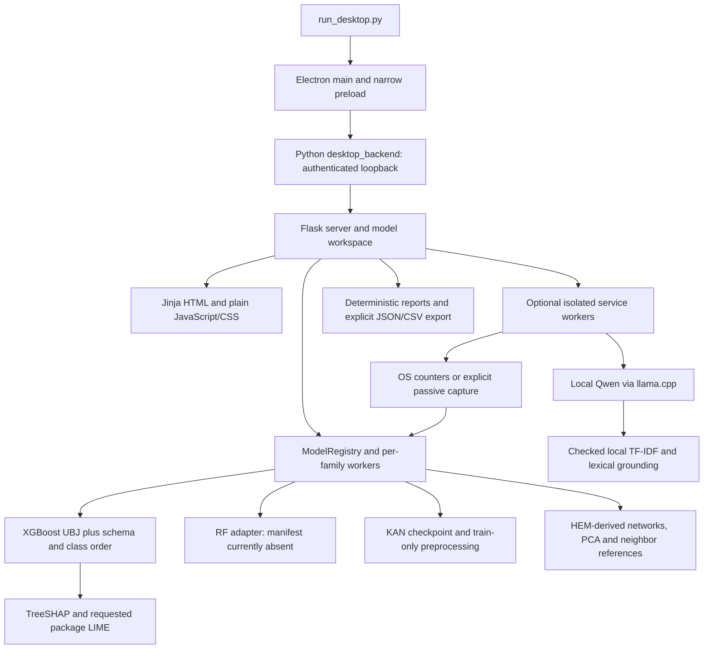

# Architecture and capability baseline

Inspected 20 October 2026. Sources: complete `PROJECT_CONTEXT.md`, `ARCHITECTURE.md`, `APP.md`, `DESKTOP.md`, `LIVE_MONITORING.md`, `PARTIAL_INPUTS.md`, `RAG.md`, `FOUR_MODEL_APP.md`, `RUST_MIGRATION.md`, current runtime and Phase 1 evidence. Current software behavior and research accuracy remain separate.

## Actual dependency graph

There is no integrated Rust backend, React renderer or TypeScript toolchain. `rust/spikes/*` contains four standalone packages. Electron still starts Python or the existing frozen executable (`main.cjs:54`); no `NETSEC_BACKEND` selector exists. Python research/demo tools are separate and remain outside modernization.

## Entry points and user flows

| Boundary | Actual flow and failure behavior | Evidence |
| --- | --- | --- |
| Desktop | `run_desktop.py` -> Electron -> `framework.app.desktop_backend`; stdin shutdown/EOF -> resource close -> server close | launcher; `desktop_backend.py:10`; `main.cjs:54,146` |
| Routes | Home `/`, Live `/live`, CSV `/csv`, Samples `/samples`, Models `/models`; loading/error/exit pages; local static assets | `server.py:180`; `templates/`; `static/` |
| Sample | UI selection -> POST `/api/analyze` -> lazy XGBoost snapshot/worker -> saved-model prediction -> native TreeSHAP -> deterministic report -> renderer JSON export | `server.py`; `lazy_xgboost.py`; `trained_xgboost.py`; `app.js:1008` |
| CSV | Multipart `/api/upload` -> schema-1/2 parser -> up to 500 predictions -> row selection `/api/explain` -> SHAP/report -> JSON download | `server.py`; `trained_xgboost.py:41`; `data/feature_schema.py` |
| Model workspace | `/api/models` catalog and recorded comparison; explicitly selected predict/upload/explain routes; prepared numeric CSV aligned by names | `model_workspace.py:18`; `core/registry.py:52,109,163` |
| Live | Explicit `/api/live/start`; isolated monitor owns OS observations or Npcap headers; counts/rules separate from binary and partial multiclass models; Stop invalidates current predictions | `server.py`; `core/capabilities.py`; `data/live_monitor.py:131,225` |
| Live export | Feature CSV/XAI/assistant require current observation ID; generic live-report endpoint only checks packet count and can retain stopped observations | `server.py:308,319`; security finding SEC-03 |
| Assistant | Requested evidence -> checked local retrieval -> actual Qwen generation -> bounded lexical checks/retry; failure is explicit | `llm/local_model.py`; `rag/retrieval.py`, `grounding.py` |

The live/CSV/explanation paths above are source traces, not fresh end-to-end success claims. Fresh desktop Samples failed; standalone sample prediction/SHAP succeeded. No capture or generation was requested in this Stage 0 run. Uploads are in memory; exports are user actions. There is no general durable workspace/job database with migrations, cancellation IDs and recoverable upgrades yet. Existing request generations protect several renderer responses; this is not a complete job-management protocol.

## Model and schema matrix

Runtime inventory: `artifacts/delivery/20261020/dependency-inventory.json`.

| Family/path | Input and artifact | Actual current status |
| --- | --- | --- |
| Legacy/promoted XGBoost | Schema 1 full DataSense: 71 numeric + frozen protocol expansion to 170 columns; schema 2 partial: same 170, nullable measurements; 84 ordered classes; UBJ with SHA256 | Standalone current sample and exact SHAP executed; desktop HTTP worker path failed |
| Models XGBoost | `four_models/xgboost.json` -> `xgboost_bundle.json`, partial-v1-fresh_d6_smooth_s42, 170/84 | Catalog ready means configured/existing, not loaded/integrity-qualified; no new promotion |
| Random Forest | Adapter supports declared saved forest variants; expected `four_models/random_forest.json` absent | Unavailable; do not select a research checkpoint to hide absence |
| KAN | Preserved 71-input/84-class PyTorch checkpoint, saved train-only preprocessing and schema identities | Manifest/checkpoint paths present; not freshly executed here; not the later 655-feature study |
| HEM-derived | Preserved 71-input/84-class neural components, PCA/preprocessing and nearest-training-neighbor references | Manifest/checkpoint paths present; not freshly executed; closed-set voting, no supported class probabilities or original unknown-attack claim |
| Binary packet XGBoost | Seven packet/TCP-flag counts, binary UBJ | Separate comparison; compatible only with valid nonempty approximately ten-second windows |
| Multiclass live | Seven measured counts +163 NaNs in the 170-column partial schema | Source implemented; no arbitrary sensor/protocol filling; no new live validation |
| Original HEM bridge | Original protocol/artifacts needed | Explicitly unavailable adapter; not the HEM-derived model |
| Synthetic CLI | Six invented features, DemoDetector, simplified contributions, TemplateProvider | All five CLI commands executed; not research inference |

All ordered names, classes, preprocessing ownership and hashes must be carried into migration contracts. New 655-feature research artifacts are not drop-in replacements for these app schemas. Do not inspect locked test arrays or promote ongoing-study outputs to satisfy packaging.

## Six requested XAI methods

`I` means implementation found; `M` means missing in current runtime; no universal support is implied.

| Method | XGBoost | RF | KAN | HEM-derived | Evidence/constraint |
| --- | --- | --- | --- | --- | --- |
| SHAP | I, exact native TreeSHAP on raw margins | M | M | M | `xai/tree_shap.py`; XGBoost adapter `explain`; standalone reconstruction checked |
| LIME | I, actual package + training reference | M | M | M | `xai/model_evidence.py`; missingness/count constraints and R² limits |
| Anchors | M | M | M | M | No runtime dispatcher or implementation found |
| Constrained counterfactuals | M | M | M | M | Need explicit measured/derived feature constraints and validity checks |
| Grouped permutation importance | M | M | M | M | Native gain/impurity statistics do not implement grouped permutation |
| ALE | M | M | M | M | Need approved compatible reference data and bounded global jobs |

Other existing explanations: RF global importance (`adapters/random_forest.py:99`); KAN gradient-times-scaled-input sensitivity (`kan.py:104`); HEM component/PCA/neighbor diagnostics (`hem.py:268`). These are not SHAP, LIME or explanations of a combined hybrid predictor. An explanation error must preserve a valid prediction.

## Rust evidence already present

| Spike | Inspected historical evidence | Decision and remaining dependency |
| --- | --- | --- |
| XGBoost | `phase1/xgboost-expanded/summary.json`: six passing executed cases, including original/partial real checkpoints and binary packet checkpoint; max probability difference 5.960464477539063e-8; matching sampled margins/SHAP and ordering | Reuse numeric gbtree implementation; not a complete backend. Categorical/DART/vector leaves/interactions remain unsupported. Timing scopes differ, so no speedup claim |
| LIME | `phase1/lime/parity.json`: algorithm feasibility go; drop-in replacement **no-go** | Keep Python package. Rust RNG/numeric/constant-R² and ranking deviations need explicit review and distinct labeling |
| LLM | `phase1/llm/measurements/`: actual Qwen with synthetic evidence; text equal across three evidence cases, 13/13 grounding cases, refusal checks passed | More complete than the earlier memory snapshot. Historical execution only; keep supervised native process boundary, no quality benchmark |
| Capture | `phase1/capture/report.json`: `go_enumeration_only`; ten historical Rust unit tests | OS/Npcap enumeration and synthetic replay are not live capture; opening handles, permission/start/stop, passive headers and native crash isolation unexecuted |

The migration contract uses probability/margin tolerance 1e-5, SHAP 1e-4, exact argmax/stable top-three, and reconstruction checks (`RUST_MIGRATION.md`, risk register). Refresh selected parity without regenerating fixtures after any runtime change. Existing Phase 1 work does not authorize the Phase 2 skeleton.
